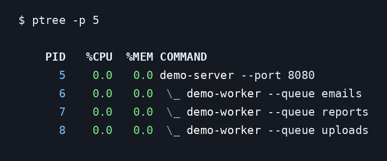

# ptree

Shows a process and everything it started as a tree, with PID, CPU, memory,
and the full command line. Linux only.



## Why

I kept wanting to look at one process and its children: a build, a server
with its workers, a script that spawned who knows what. `pstree` draws the
tree but doesn't tell you how busy anything is or how much memory it holds.
`ps --forest` has the columns I want, but `-p` picks only the PIDs you list,
not their children, so you either get the whole system or end up scripting
around it. htop can do all of this and I love it, but most of the time it's
more than I need. I just want a plain, read-only tree, no meters or gauges.

That's what ptree is.

## Install

You need Linux, a C compiler, and Make.

```sh
make
sudo install -m 755 ptree /usr/local/bin/ptree
```

## Use

```sh
ptree -p 1234              # a process and its descendants
ptree -f 'demo-server'     # match full command lines (extended regex)
ptree --watch=1 -p 1234    # refresh every second
ptree -l -p 1234           # one PID per line
ptree -c -p 1234           # comma-separated PIDs
```

When you do need more columns, hand the PIDs to `ps`:

```sh
ps -o pid,ppid,user,stat,etime,%cpu,%mem,args --forest -p "$(ptree -c -p 1234)"
```

`ptree --help` lists the rest.
